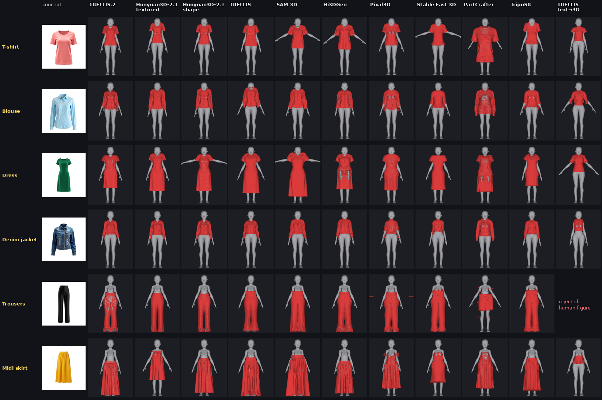
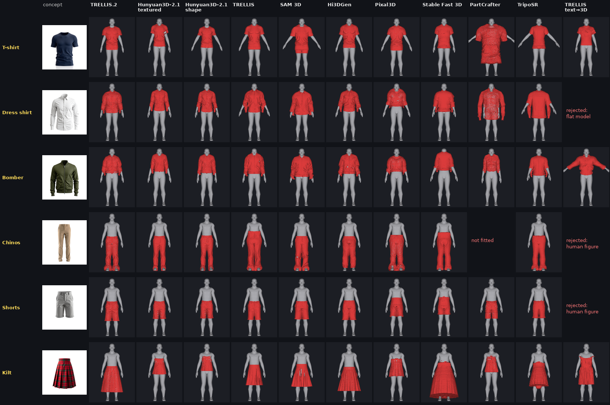
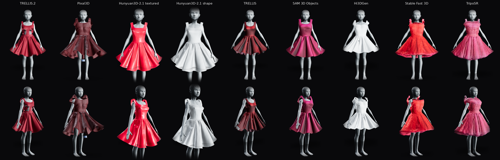
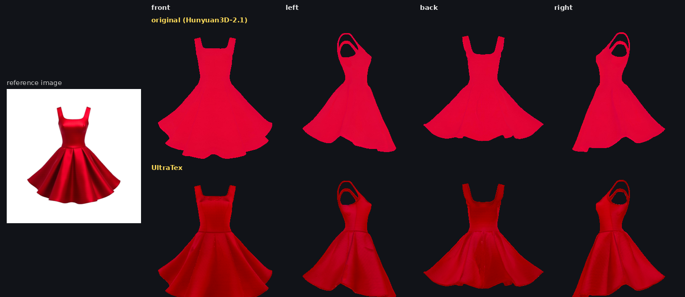
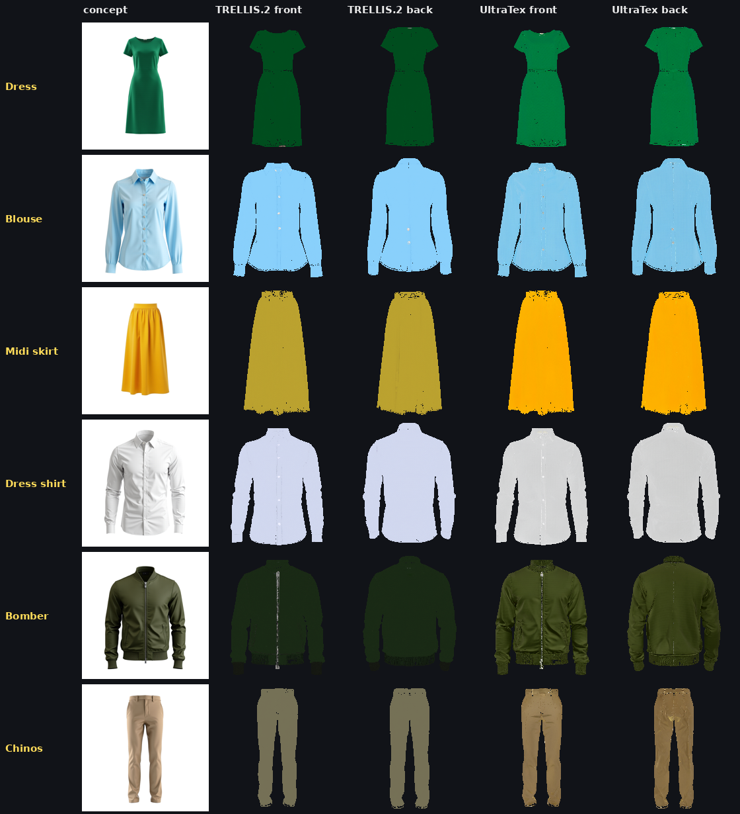
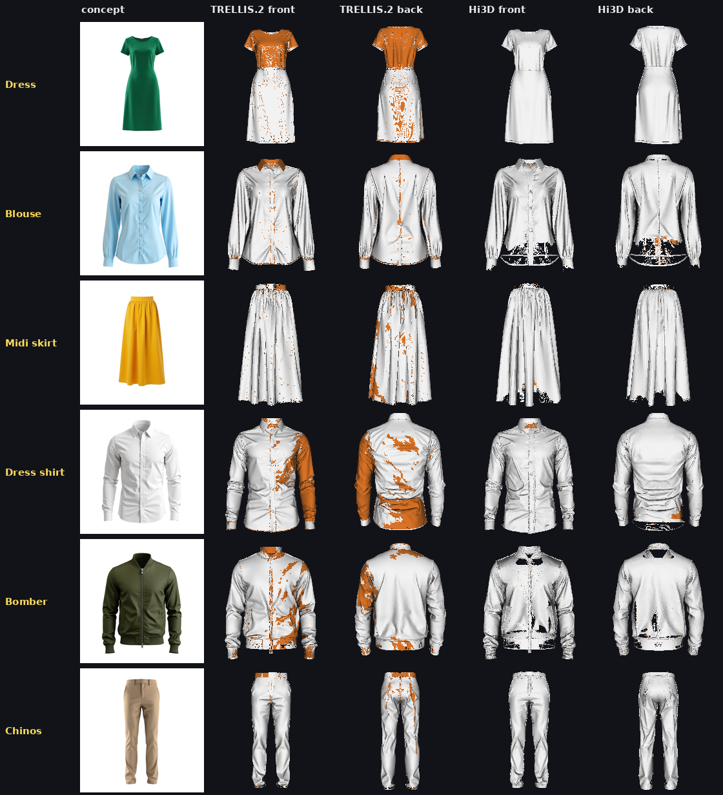
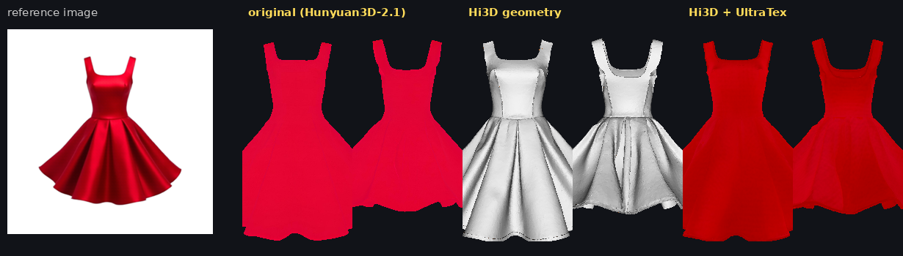

# Engine guide / Motor kılavuzu

**English** · [Türkçe](#türkçe)

## English

Which local engine should you use to turn a garment photo into a 3D model that can be dressed
on a mannequin? We ran **every installed engine** on the same garments, dressed every result
automatically with the same code, and compared them side by side.

- **12 garments** (6 women's, 6 men's: t-shirt, blouse/shirt, dress, jacket, trousers,
  skirt/shorts/kilt), concept images made with FLUX.1-dev, plus the
  [red "New Look" dress](../red-new-look-dress/README.md).
- **11 engine modes**, run one after another on 2× RTX 3090 (24 GB). Nothing was adjusted by
  hand; every garment was dressed on the female or male base mannequin.
- Images below: front view of the dressed garment (simple preview render, same colour for
  every engine, so you compare **shape and fit**, not texture).

### Recommendation

| Goal | Engine |
|---|---|
| Garments, best overall | **TRELLIS.2** (`trellis2-image`) |
| Best texture / colour | Hunyuan3D-2.1 textured (`hunyuan-textured`) |
| Free licence, no gated weights | TRELLIS (`trellis-image`) |
| Quick look in seconds | TripoSR (`triposr`) |
| New texture from an image, same shape | UltraTex (`ultratex-retexture`) |
| Sharper shape detail on an existing model | Hi3D (`hi3d-refine`), then UltraTex |
| Low VRAM (≤ 8 GB) | Hunyuan3D-2.1 shape, Stable Fast 3D, TripoSR |

### Women's garments

### Men's garments

### The red dress through every engine

### Engines

| Engine (id) | Install | Input | ~VRAM | Time / garment | Dressed | Arm crossing | Gated | Licence | Verdict |
|---|---|---|---|---|---|---|---|---|---|
| `trellis2-image` | `trellis2` | photo | ~18 GB | ~80 s | 13/13 | 0.006 | DINOv3 (Meta) | MIT | **Best for garments.** Open surfaces (arm/neck openings stay open), clean shapes, believable back. Some grey blotches in the texture. |
| `hunyuan-textured` | `hunyuan` | photo | ~22 GB | ~292 s | 12/12 | 0.003 | terms | Tencent Community (non-commercial-ish) | Best texture (PBR, faithful colour). Closed shapes; the back is invented (open back / lump on dresses). |
| `hunyuan-image` | `hunyuan` | photo | ~8 GB | ~96 s | 13/13 | 0.015 | terms | Tencent Community (non-commercial-ish) | Same clean shape as textured, without texture. Good fast preview of the shape. |
| `trellis-image` | `trellis` | photo / multi-photo | ~12 GB | ~64 s | 13/13 | 0.003 | no | MIT | Solid all-rounder; fits well. Dark streaks and holes in skirts, weaker texture. |
| `sam3d-image` | `sam3d` | real photo | ~24 GB | ~111 s | 13/13 | 0.03 | Meta SAM licence | SAM License (conditional) | Good silhouette and fit; colour drifts (red → magenta), sparse mesh. |
| `hi3dgen-image` | `hi3dgen` | photo / multi-photo | ~14 GB | ~20 s | 13/13 | 0.002 | no | MIT | Sharp geometry, no texture. Garments come out a bit short; straps/collars can crumple. |
| `pixal3d-image` | `pixal3d` | photo | ~12 GB | ~243 s | 13/13 | 0.029 | DINOv3 (Meta) | MIT | Follows the photo's camera (pixel-aligned): perspective tilt and loose fragments on studio shots. Try `fov` 0.2. |
| `sf3d-image` | `sf3d` | photo | ~7 GB | ~117 s | 13/13 | 0.022 | Stability (gated) | Stability Community (<$1M) | Fast, PBR; lumpy surface, garments too wide and closed. |
| `partcrafter-image` | `partcrafter` | photo | ~12 GB | ~119 s | 11/12 | 0.096 | no* | MIT code, NC matte | Splits into parts; boxy garments with loose pieces; sleeves often miss the arms. |
| `triposr` | `triposr` | photo | ~6 GB | ~5 s | 13/13 | 0.0 | no | MIT | Fastest (seconds); low detail, blobby and closed. Good for a quick check only. |
| `trellis-text` | `trellis` | text | ~10 GB | ~58 s | 8/12 | 0.005 | no | MIT | Text only. Tops are fine; for trousers/shorts it often makes a *person wearing* them (now rejected with a clear message). |

- **Time** is the median per garment in this run (first-job model loading included). TRELLIS.2:
  ~40 s shape + texture and ~40 s export with models kept on the GPU (the default now).
- **Dressed**: garments the automatic fit accepted. Rejections are deliberate (a human figure
  or a flat model instead of a garment).
- **Arm crossing**: share of the posed arm surface inside the fabric; 0 = the arms never cut
  through the garment. Sleeved tops score ~0.05–0.13 because tight sleeves touch the arm.
- **Gated**: DINOv3 (TRELLIS.2, Pixal3D) and SAM 3D need access approved on Hugging Face;
  put your Hugging Face token in `.env` as `HF_TOKEN` before installing.
- Install / run: `bash infra/scripts/engine.sh install <name>` then
  `bash infra/scripts/start-linux.sh` (starts every installed engine unless `ENABLED_ENGINES`
  lists a subset).

### Texture from an image: UltraTex (FLUX.2-klein + Qwen3-8B)

UltraTex redraws the **texture** of a model you already have; the shape is not touched. It
renders the model's surface normals from 6 fixed cameras, and **FLUX.2-klein 9B** with the
UltraTex LoRA paints a matching albedo for all 6 views at once, guided by one reference image
(the text encoder is **Qwen3-8B**, always run with an empty prompt). The 6 views are then baked
back onto the model's UV map.

What it does well, on these garments: the colour follows the reference much more closely than
the engines' own textures (yellow skirt instead of mustard, beige chinos instead of grey, white
shirt instead of lilac), and printed details appear on every side (bomber zip and pockets,
dress-shirt buttons, the satin sheen and waist seam of the red dress). Shading from the
reference is baked into the albedo, so the model looks lit even under flat light.

- In the app: **Design → Texture from image (UltraTex)**. Pick a reference image, or leave it
  empty to use the design's own image. A new design is created; mannequin and measurements are
  kept, because the geometry is the same.
- API: `POST /generate/retexture-image` (`source_project_id`, optional `file`).
- Install: `bash infra/scripts/engine.sh install ultratex`. Weights: FLUX.2-klein-base-9B
  (accept the BFL licence on Hugging Face), Qwen3-8B (Apache-2.0), FLUX.2 VAE (Comfy-Org
  copy), UltraTex LoRA + decoder (ModelScope), about 35 GB in total.
- Hardware: made for one 80 GB card. On **2× 24 GB** the worker splits the work: Qwen3-8B
  encodes once on the second card and is freed, then half of the DiT blocks move there.
  1024 px per view takes **5–9 min** per garment. One 24 GB card is not enough at 1024.
- Licence: code MIT; FLUX.2-klein weights under the BFL licence (**non-commercial**).
- Limits: parts no camera sees (inside the neckline, under the arms) get the old texture or the
  nearest colour; a reference that shows only the front means the back is invented.

### Shape detail: Hi3D v1.0

Hi3D v1.0 (Sparc3D-based, released October 2026) rebuilds the **shape** of a model you
already have at a higher resolution, guided by the same reference image: the coarse mesh
gives the overall form, the image gives the detail (collar, seams, gathers, folds). It
produces geometry only, so the app hands the result straight to UltraTex for a new texture.

What we saw on these garments:

- **Dress, skirt, chinos:** clean, smooth fabric with sharper seams, waistband and gathers;
  TRELLIS.2's flipped-normal patches (orange above) are gone.
- **Blouse, dress shirt, bomber:** body and sleeves get finer, but the hem, the bomber's rib
  knit and the collar **tear** where the fabric is thin and layered. This comes from the
  model itself, so pick these results by eye.
- Hi3D closes every hole by default, which turns a garment into a solid (the hem and
  neckline get capped and a mannequin cannot go inside). Our worker keeps the **openings**
  (neckline, armholes, hem, legs) open and fills only short loops (pinholes). The **Keep
  openings** option turns this off for closed objects.
- The result is put back into the source model's bounding box, so mannequin and
  measurements still line up and the new design inherits them.

- In the app: **Design → Add shape detail (Hi3D)** uses the design's own image; a new design
  is created and, by default, retextured by UltraTex. The red dress took **29 min** end to
  end on 2× 24 GB (Hi3D 8 min, UltraTex 21 min: the new mesh has no UV map yet and
  unwrapping 200k faces adds ~10 min).
- API: `POST /generate/refine` with `"engine_id": "hi3d-refine"` (`advanced`:
  `resolution` 512/1024/1536, `faces`, `keep_openings`, `retexture`).
- Install: `bash infra/scripts/engine.sh install hi3d`. Weights: hi3d-official/Hi3Dv1.0
  (7.7 GB, open) plus DINOv2-large and CLIP ViT-L/14 (~3 GB).
- Hardware: **one 24 GB card at 1024** (12–20 GB peak, **3.5–11 min** per garment).
  1536 fitted the dress (16 GB, 11 min) but the bomber needed 30 GB and spilled into
  shared system memory (27 min): use 1536 only on simple shapes or bigger cards.
- Licence: Hi3D Open License 1.0, **commercial use allowed** with a visible "Powered by
  Hi3D 1.0" link to hi3d.ai (the app shows it next to the button); a separate licence is
  needed above 200,000 monthly users or USD 1M monthly revenue.

### Known issues

- Tight sleeves on jackets and shirts still touch the arm.
- Generated trousers often have narrow hips; the fit keeps them at the waist and pushes the
  hips out, which can leave a bulge at the back.
- Hunyuan3D's kilt is placed like a tube top on the chest.
- Single-photo engines invent the back; a multi-view input (front/side/back) is the next step.
- UltraTex is slow on 24 GB cards and needs two of them.
- Hi3D tears thin, layered fabric (shirt hems, rib knit, collars).

## Türkçe

Bir kıyafet fotoğrafını mankene giydirilebilen 3D modele çevirmek için hangi yerel motoru
kullanmalı? **Kurulu tüm motorları** aynı kıyafetlerle çalıştırdık, her sonucu aynı kodla
otomatik giydirdik ve yan yana karşılaştırdık.

- **12 kıyafet** (6 kadın, 6 erkek: tişört, bluz/gömlek, elbise, ceket, pantolon,
  etek/şort/kilt), konsept görseller FLUX.1-dev ile; ayrıca
  [kırmızı "New Look" elbise](../red-new-look-dress/README.md).
- **11 motor modu**, 2× RTX 3090 (24 GB) üzerinde sırayla. Elle hiçbir ayar yapılmadı; her
  kıyafet kadın ya da erkek taban mankene giydirildi.
- Aşağıdaki görseller: giydirilmiş kıyafetin önden görünümü (basit önizleme render'ı, her
  motorda aynı renk; yani **şekil ve oturuşu** karşılaştırırsınız, dokuyu değil).

### Öneri

| Amaç | Motor |
|---|---|
| Kıyafet, genel en iyi | **TRELLIS.2** (`trellis2-image`) |
| En iyi doku / renk | Hunyuan3D-2.1 dokulu (`hunyuan-textured`) |
| Serbest lisans, erişim izni yok | TRELLIS (`trellis-image`) |
| Saniyeler içinde hızlı bakış | TripoSR (`triposr`) |
| Aynı şekle görselden yeni doku | UltraTex (`ultratex-retexture`) |
| Var olan modele daha ince şekil detayı | Hi3D (`hi3d-refine`), ardından UltraTex |
| Düşük VRAM (≤ 8 GB) | Hunyuan3D-2.1 şekil, Stable Fast 3D, TripoSR |

### Kadın kıyafetleri

### Erkek kıyafetleri

### Kırmızı elbise tüm motorlarda

### Motorlar

| Motor (id) | Kurulum | Girdi | ~VRAM | Süre / kıyafet | Giydirilen | Kol kesişmesi | Erişim izni | Lisans | Değerlendirme |
|---|---|---|---|---|---|---|---|---|---|
| `trellis2-image` | `trellis2` | photo | ~18 GB | ~80 sn | 13/13 | 0.006 | DINOv3 (Meta) | MIT | **Kıyafet için en iyisi.** Açık yüzey (kol/boyun ağzı açık kalır), temiz şekil, inandırıcı sırt. Dokuda yer yer gri lekeler. |
| `hunyuan-textured` | `hunyuan` | photo | ~22 GB | ~292 sn | 12/12 | 0.003 | terms | Tencent Community (non-commercial-ish) | En iyi doku (PBR, renk sadık). Kapalı şekil; sırtı uyduruyor (elbisede açık sırt / kütle). |
| `hunyuan-image` | `hunyuan` | photo | ~8 GB | ~96 sn | 13/13 | 0.015 | terms | Tencent Community (non-commercial-ish) | Dokulu sürümle aynı temiz şekil, dokusuz. Şekli hızlı görmek için iyi. |
| `trellis-image` | `trellis` | photo / multi-photo | ~12 GB | ~64 sn | 13/13 | 0.003 | no | MIT | Sağlam, genel amaçlı; iyi oturuyor. Eteklerde koyu çizgi ve delik, doku zayıf. |
| `sam3d-image` | `sam3d` | real photo | ~24 GB | ~111 sn | 13/13 | 0.03 | Meta SAM licence | SAM License (conditional) | Silüet ve oturma iyi; renk kayıyor (kırmızı → macenta), seyrek mesh. |
| `hi3dgen-image` | `hi3dgen` | photo / multi-photo | ~14 GB | ~20 sn | 13/13 | 0.002 | no | MIT | Keskin geometri, dokusuz. Kıyafetler biraz kısa; askı/yaka buruşabiliyor. |
| `pixal3d-image` | `pixal3d` | photo | ~12 GB | ~243 sn | 13/13 | 0.029 | DINOv3 (Meta) | MIT | Fotoğrafın kamerasını izliyor (piksel hizalı): stüdyo görselinde perspektif eğimi ve kopuk parçalar. `fov` 0.2 deneyin. |
| `sf3d-image` | `sf3d` | photo | ~7 GB | ~117 sn | 13/13 | 0.022 | Stability (gated) | Stability Community (<$1M) | Hızlı, PBR; yüzey topak topak, kıyafet geniş ve kapalı. |
| `partcrafter-image` | `partcrafter` | photo | ~12 GB | ~119 sn | 11/12 | 0.096 | no* | MIT code, NC matte | Parçalara ayırıyor; kutu gibi kıyafet, kopuk parçalar; kollar kolluğa çoğu zaman girmiyor. |
| `triposr` | `triposr` | photo | ~6 GB | ~5 sn | 13/13 | 0.0 | no | MIT | En hızlı (saniyeler); az detay, şişkin ve kapalı. Yalnız hızlı kontrol için. |
| `trellis-text` | `trellis` | text | ~10 GB | ~58 sn | 8/12 | 0.005 | no | MIT | Yalnız metin. Üstler iyi; pantolon/şortta çoğu zaman onları *giyen bir insan* üretiyor (artık net mesajla reddediliyor). |

- **Süre**: bu koşudaki kıyafet başına medyan (ilk işin model yüklemesi dahil). TRELLIS.2:
  modeller GPU'da tutulunca (artık varsayılan) ~40 sn şekil + doku ve ~40 sn dışa aktarma.
- **Giydirilen**: otomatik oturtmanın kabul ettiği kıyafetler. Retler bilinçli (kıyafet yerine
  insan figürü ya da yatık model).
- **Kol kesişmesi**: pozlu kol yüzeyinin kumaş içinde kalan oranı; 0 = kollar kumaşı hiç
  kesmiyor. Kolluklu üstlerde dar kolluk kola değdiği için ~0.05–0.13.
- **Erişim izni**: DINOv3 (TRELLIS.2, Pixal3D) ve SAM 3D için Hugging Face'te erişim onayı
  gerekir; kurmadan önce Hugging Face token'ınızı `.env` dosyasına `HF_TOKEN` olarak yazın.
- Kurulum / çalıştırma: `bash infra/scripts/engine.sh install <ad>`, ardından
  `bash infra/scripts/start-linux.sh` (`ENABLED_ENGINES` bir alt küme vermedikçe kurulu tüm
  motorları başlatır).

### Görselden doku: UltraTex (FLUX.2-klein + Qwen3-8B)

UltraTex elinizdeki modelin **dokusunu** yeniden çizer; şekle dokunmaz. Modelin yüzey
normallerini 6 sabit kameradan render eder; **FLUX.2-klein 9B** ve UltraTex LoRA'sı tek bir
referans görsele bakarak 6 görünümün albedo'sunu birlikte boyar (metin kodlayıcı
**Qwen3-8B**, prompt hep boş). Ardından 6 görünüm modelin UV dokusuna geri işlenir.

Bu kıyafetlerde iyi yaptığı: renk, motorların kendi dokusuna göre referansa çok daha yakın
(hardal yerine sarı etek, gri yerine bej chino, lila yerine beyaz gömlek) ve detaylar her
yüzde çıkıyor (bomber fermuarı ve cepleri, gömlek düğmeleri, kırmızı elbisenin saten parlaklığı
ve bel dikişi). Referanstaki gölgelendirme albedo'ya işleniyor; model düz ışıkta da ışıklı
görünür.

- Uygulamada: **Tasarım → Görselden doku (UltraTex)**. Bir referans görsel seçin ya da boş
  bırakın (tasarımın kendi görseli kullanılır). Yeni bir tasarım açılır; geometri aynı olduğu
  için manken ve ölçüler korunur.
- API: `POST /generate/retexture-image` (`source_project_id`, isteğe bağlı `file`).
- Kurulum: `bash infra/scripts/engine.sh install ultratex`. Ağırlıklar: FLUX.2-klein-base-9B
  (Hugging Face'te BFL lisansını kabul edin), Qwen3-8B (Apache-2.0), FLUX.2 VAE (Comfy-Org
  kopyası), UltraTex LoRA + decoder (ModelScope); toplam ~35 GB.
- Donanım: tek 80 GB kart için yapılmış. **2× 24 GB**'ta worker işi böler: Qwen3-8B ikinci
  kartta bir kez kodlayıp bırakılır, ardından DiT bloklarının yarısı oraya taşınır. Görünüm
  başına 1024 px ile kıyafet başına **5–9 dk**. Tek 24 GB kart 1024'te yetmez.
- Lisans: kod MIT; FLUX.2-klein ağırlıkları BFL lisansı (**ticari değil**).
- Sınırlar: hiçbir kameranın görmediği yerler (yaka içi, koltuk altı) eski dokudan ya da en
  yakın renkten doldurulur; referans yalnız önü gösteriyorsa sırt uydurulur.

### Şekil detayı: Hi3D v1.0

Hi3D v1.0 (Sparc3D tabanlı, Ekim 2026) elinizdeki modelin **şeklini** aynı referans görsele
göre daha yüksek çözünürlükte yeniden üretir: kaba mesh genel formu, görsel ise detayı (yaka,
dikiş, büzgü, kırışık) verir. Yalnız geometri üretir; uygulama sonucu doğrudan UltraTex'e
verip yeni doku çizdirir.

Bu kıyafetlerde gördüklerimiz:

- **Elbise, etek, kumaş pantolon:** pürüzsüz, temiz kumaş; dikiş, bel bandı ve büzgüler
  daha keskin; TRELLIS.2'nin ters normal lekeleri (yukarıda turuncu) kayboluyor.
- **Bluz, gömlek, bomber:** gövde ve kollar incelir ama etek ucu, bomber'ın ribanası ve yaka,
  kumaşın ince ve katmanlı olduğu yerlerde **yırtılıyor**. Bu modelin kendisinden geliyor;
  bu sonuçları gözle seçin.
- Hi3D normalde her deliği kapatır ve kıyafeti katı bir cisme çevirir (etek ucu ve yaka
  kapanır, manken içine giremez). Worker'ımız **açıklıkları** (yaka, kol ağzı, etek ucu,
  paçalar) açık bırakır, yalnız kısa halkaları (iğne delikleri) doldurur. Kapalı nesneler
  için **Açıklıkları koru** seçeneği kapatılabilir.
- Sonuç kaynak modelin kutusuna geri oturtulur; manken ve ölçüler hizalı kalır, yeni tasarım
  bunları devralır.

- Uygulamada: **Tasarım → Şekli detaylandır (Hi3D)** tasarımın kendi görselini kullanır; yeni
  bir tasarım açılır ve varsayılan olarak UltraTex ile dokulanır. Kırmızı elbise 2× 24 GB'da
  uçtan uca **29 dk** sürdü (Hi3D 8 dk, UltraTex 21 dk: yeni mesh'in UV haritası yok, 200 bin
  yüzü açmak ~10 dk ekliyor).
- API: `POST /generate/refine`, `"engine_id": "hi3d-refine"` (`advanced`: `resolution`
  512/1024/1536, `faces`, `keep_openings`, `retexture`).
- Kurulum: `bash infra/scripts/engine.sh install hi3d`. Ağırlıklar: hi3d-official/Hi3Dv1.0
  (7,7 GB, açık) + DINOv2-large ve CLIP ViT-L/14 (~3 GB).
- Donanım: **1024'te tek 24 GB kart** (tepe 12–20 GB, kıyafet başına **3,5–11 dk**).
  1536 elbiseye sığdı (16 GB, 11 dk) ama bomber 30 GB istedi ve paylaşılan sistem belleğine
  taştı (27 dk): 1536'yı yalnız sade şekillerde ya da büyük kartlarda kullanın.
- Lisans: Hi3D Open License 1.0, **ticari kullanım serbest**; hi3d.ai'ye bağlantılı görünür
  "Powered by Hi3D 1.0" ibaresi şart (uygulama düğmenin yanında gösteriyor); aylık 200 bin
  kullanıcı ya da 1 milyon USD aylık gelir üstünde ayrı lisans gerekir.

### Bilinen sorunlar

- Ceket ve gömleklerde dar kolluk hâlâ kola değiyor.
- Üretilen pantolonların kalçası çoğu zaman dar; oturtma pantolonu belde tutup kalçayı dışa
  itiyor, arkada şişkinlik kalabiliyor.
- Hunyuan3D'nin kilti göğse tüp gibi yerleşiyor.
- Tek fotoğraftan çalışan motorlar sırtı uyduruyor; sıradaki adım çok-görünümlü girdi (ön/yan/arka).
- UltraTex 24 GB kartlarda yavaş ve iki kart istiyor.
- Hi3D ince ve katmanlı kumaşı (gömlek eteği, riba, yaka) yırtıyor.
