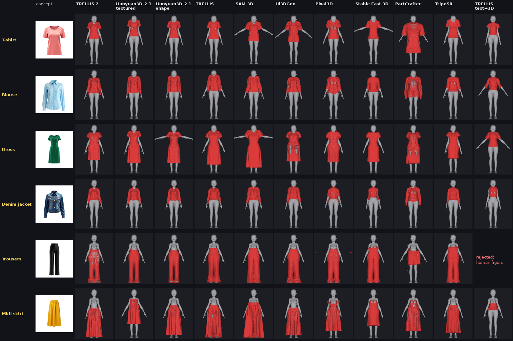
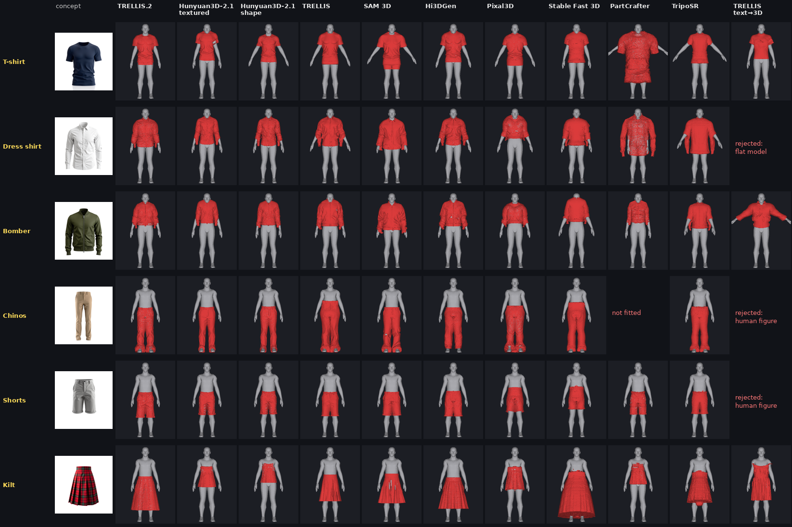
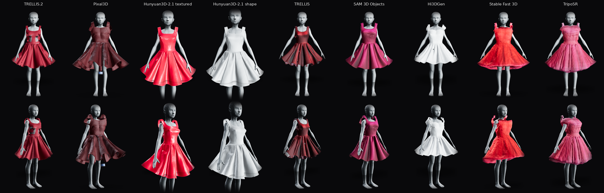
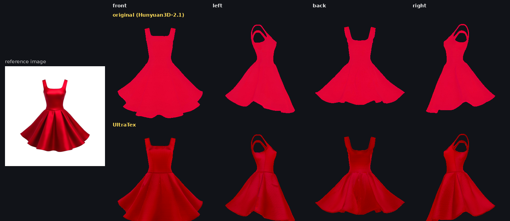
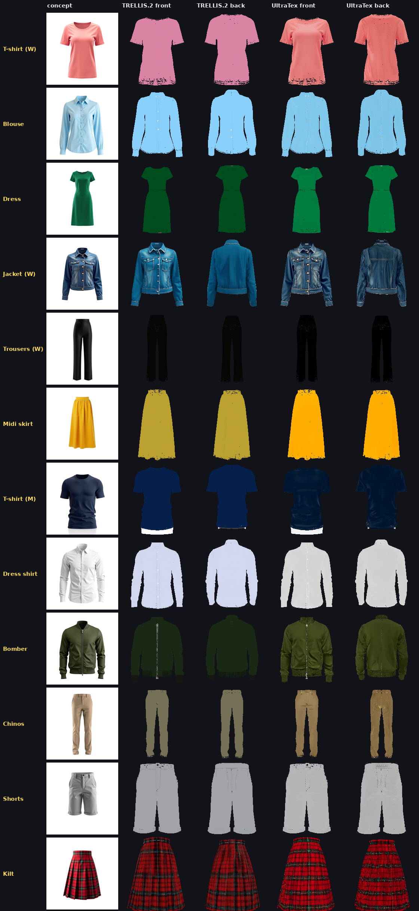
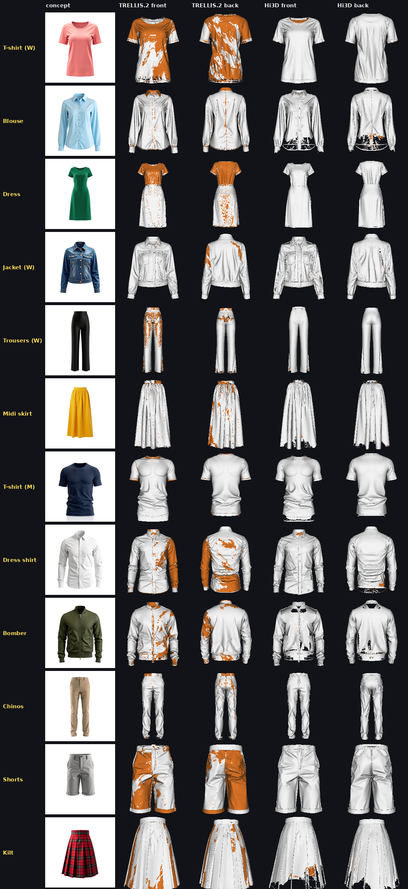
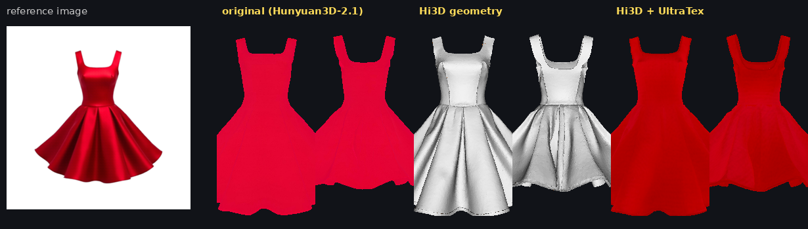

# Motor kılavuzu

[English](README.md) · **Türkçe**

Bir kıyafet fotoğrafını mankene giydirilebilen 3D modele çevirmek için hangi yerel motoru
kullanmalı? **Kurulu tüm motorları** aynı kıyafetlerle çalıştırdık, her sonucu aynı kodla
otomatik giydirdik ve yan yana karşılaştırdık.

- **12 kıyafet** (6 kadın, 6 erkek: tişört, bluz/gömlek, elbise, ceket, pantolon,
  etek/şort/kilt), konsept görseller FLUX.1-dev ile; ayrıca
  [kırmızı "New Look" elbise](../red-new-look-dress/README.md).
- **11 motor modu**, 2× RTX 3090 (24 GB) üzerinde sırayla. Elle hiçbir ayar yapılmadı; her
  kıyafet kadın ya da erkek taban mankene giydirildi.
- Aşağıdaki görseller: giydirilmiş kıyafetin önden görünümü (basit önizleme render'ı, her
  motorda aynı renk; yani **şekil ve oturuşu** karşılaştırırsınız, dokuyu değil).

## Öneri

| Amaç | Motor |
|---|---|
| Kıyafet, genel en iyi | **TRELLIS.2** (`trellis2-image`) |
| En iyi doku / renk | Hunyuan3D-2.1 dokulu (`hunyuan-textured`) |
| Serbest lisans, erişim izni yok | TRELLIS (`trellis-image`) |
| Saniyeler içinde hızlı bakış | TripoSR (`triposr`) |
| Aynı şekle görselden yeni doku | UltraTex (`ultratex-retexture`) |
| Var olan modele daha ince şekil detayı | Hi3D (`hi3d-refine`), ardından UltraTex |
| Düşük VRAM (≤ 8 GB) | Hunyuan3D-2.1 şekil, Stable Fast 3D, TripoSR |

## Kadın kıyafetleri

## Erkek kıyafetleri

## Kırmızı elbise tüm motorlarda

## Motorlar

| Motor (id) | Kurulum | Girdi | ~VRAM | Süre / kıyafet | Giydirilen | Kol kesişmesi | Erişim izni | Lisans | Değerlendirme |
|---|---|---|---|---|---|---|---|---|---|
| `trellis2-image` | `trellis2` | photo | ~18 GB | ~80 sn | 13/13 | 0.006 | DINOv3 (Meta) | MIT | **Kıyafet için en iyisi.** Açık yüzey (kol/boyun ağzı açık kalır), temiz şekil, inandırıcı sırt. Dokuda yer yer gri lekeler. |
| `hunyuan-textured` | `hunyuan` | photo | ~22 GB | ~292 sn | 12/12 | 0.003 | terms | Tencent Community (non-commercial-ish) | En iyi doku (PBR, renk sadık). Kapalı şekil; sırtı uyduruyor (elbisede açık sırt / kütle). |
| `hunyuan-image` | `hunyuan` | photo | ~8 GB | ~96 sn | 13/13 | 0.015 | terms | Tencent Community (non-commercial-ish) | Dokulu sürümle aynı temiz şekil, dokusuz. Şekli hızlı görmek için iyi. |
| `trellis-image` | `trellis` | photo / multi-photo | ~12 GB | ~64 sn | 13/13 | 0.003 | no | MIT | Sağlam, genel amaçlı; iyi oturuyor. Eteklerde koyu çizgi ve delik, doku zayıf. |
| `sam3d-image` | `sam3d` | real photo | ~24 GB | ~111 sn | 13/13 | 0.03 | Meta SAM licence | SAM License (conditional) | Silüet ve oturma iyi; renk kayıyor (kırmızı → macenta), seyrek mesh. |
| `hi3dgen-image` | `hi3dgen` | photo / multi-photo | ~14 GB | ~20 sn | 13/13 | 0.002 | no | MIT | Keskin geometri, dokusuz. Kıyafetler biraz kısa; askı/yaka buruşabiliyor. |
| `pixal3d-image` | `pixal3d` | photo | ~12 GB | ~243 sn | 13/13 | 0.029 | DINOv3 (Meta) | MIT | Fotoğrafın kamerasını izliyor (piksel hizalı): stüdyo görselinde perspektif eğimi ve kopuk parçalar. `fov` 0.2 deneyin. |
| `sf3d-image` | `sf3d` | photo | ~7 GB | ~117 sn | 13/13 | 0.022 | Stability (gated) | Stability Community (<$1M) | Hızlı, PBR; yüzey topak topak, kıyafet geniş ve kapalı. |
| `partcrafter-image` | `partcrafter` | photo | ~12 GB | ~119 sn | 11/12 | 0.096 | no* | MIT code, NC matte | Parçalara ayırıyor; kutu gibi kıyafet, kopuk parçalar; kollar kolluğa çoğu zaman girmiyor. |
| `triposr` | `triposr` | photo | ~6 GB | ~5 sn | 13/13 | 0.0 | no | MIT | En hızlı (saniyeler); az detay, şişkin ve kapalı. Yalnız hızlı kontrol için. |
| `trellis-text` | `trellis` | text | ~10 GB | ~58 sn | 8/12 | 0.005 | no | MIT | Yalnız metin. Üstler iyi; pantolon/şortta çoğu zaman onları *giyen bir insan* üretiyor (artık net mesajla reddediliyor). |

- **Süre**: bu koşudaki kıyafet başına medyan (ilk işin model yüklemesi dahil). TRELLIS.2:
  modeller GPU'da tutulunca (artık varsayılan) ~40 sn şekil + doku ve ~40 sn dışa aktarma.
- **Giydirilen**: otomatik oturtmanın kabul ettiği kıyafetler. Retler bilinçli (kıyafet yerine
  insan figürü ya da yatık model).
- **Kol kesişmesi**: pozlu kol yüzeyinin kumaş içinde kalan oranı; 0 = kollar kumaşı hiç
  kesmiyor. Kolluklu üstlerde dar kolluk kola değdiği için ~0.05–0.13.
- **Erişim izni**: DINOv3 (TRELLIS.2, Pixal3D) ve SAM 3D için Hugging Face'te erişim onayı
  gerekir; kurmadan önce Hugging Face token'ınızı `.env` dosyasına `HF_TOKEN` olarak yazın.
- Kurulum / çalıştırma: `bash infra/scripts/engine.sh install <ad>`, ardından
  `bash infra/scripts/start-linux.sh` (`ENABLED_ENGINES` bir alt küme vermedikçe kurulu tüm
  motorları başlatır).

## Görselden doku: UltraTex (FLUX.2-klein + Qwen3-8B)

UltraTex elinizdeki modelin **dokusunu** yeniden çizer; şekle dokunmaz. Modelin yüzey
normallerini 6 sabit kameradan render eder; **FLUX.2-klein 9B** ve UltraTex LoRA'sı tek bir
referans görsele bakarak 6 görünümün albedo'sunu birlikte boyar (metin kodlayıcı
**Qwen3-8B**, prompt hep boş). Ardından 6 görünüm modelin UV dokusuna geri işlenir.

12 kıyafetin hepsinde iyi yaptığı: renk, motorların kendi dokusuna göre referansa çok daha
yakın (hardal yerine sarı etek, gri yerine bej chino, lila yerine beyaz gömlek, pembe yerine
mercan tişört) ve detaylar her yüzde çıkıyor (bomber fermuarı ve cepleri, gömlek düğmeleri,
kadın ceketinin yıkanmış denimi ve dikişleri, kiltin ekose deseni, kırmızı elbisenin saten
parlaklığı ve bel dikişi). Motorun rengi zaten doğruysa (siyah pantolon, gri şort, lacivert
tişört) fark küçük. Referanstaki gölgelendirme albedo'ya işleniyor; model düz ışıkta da ışıklı
görünür.

- Uygulamada: **Tasarım → Görselden doku (UltraTex)**. Bir referans görsel seçin ya da boş
  bırakın (tasarımın kendi görseli kullanılır). Yeni bir tasarım açılır; geometri aynı olduğu
  için manken ve ölçüler korunur.
- API: `POST /generate/retexture-image` (`source_project_id`, isteğe bağlı `file`).
- Kurulum: `bash infra/scripts/engine.sh install ultratex`. Ağırlıklar: FLUX.2-klein-base-9B
  (Hugging Face'te BFL lisansını kabul edin), Qwen3-8B (Apache-2.0), FLUX.2 VAE (Comfy-Org
  kopyası), UltraTex LoRA + decoder (ModelScope); toplam ~35 GB.
- Donanım: tek 80 GB kart için yapılmış. **2× 24 GB**'ta worker işi böler: Qwen3-8B ikinci
  kartta bir kez kodlayıp bırakılır, ardından DiT bloklarının yarısı oraya taşınır. Görünüm
  başına 1024 px ile kıyafet başına **4–12 dk**. Tek 24 GB kart 1024'te yetmez.
- Lisans: kod MIT; FLUX.2-klein ağırlıkları BFL lisansı (**ticari değil**).
- Sınırlar: hiçbir kameranın görmediği yerler (yaka içi, koltuk altı) eski dokudan ya da en
  yakın renkten doldurulur; referans yalnız önü gösteriyorsa sırt uydurulur.

## Şekil detayı: Hi3D v1.0

Hi3D v1.0 (Sparc3D tabanlı, Ekim 2026) elinizdeki modelin **şeklini** aynı referans görsele
göre daha yüksek çözünürlükte yeniden üretir: kaba mesh genel formu, görsel ise detayı (yaka,
dikiş, büzgü, kırışık) verir. Yalnız geometri üretir; uygulama sonucu doğrudan UltraTex'e
verip yeni doku çizdirir.

12 kıyafetin hepsinde gördüklerimiz:

- **Temiz (8/12): iki tişört, elbise, kadın ceketi, iki pantolon, şort, midi etek:**
  pürüzsüz kumaş; dikiş, bel bandı, cep ve büzgüler daha keskin; TRELLIS.2'nin ters normal
  lekeleri (yukarıda turuncu) kayboluyor. Erkek tişörtün etek ucunda küçük bir çentik var.
- **Yırtık (4/12): bluz, gömlek, bomber, kilt:** gövde ve kollar incelir ama etek ucu,
  bomber'ın ribanası, yaka ve kiltin pileli eteği, kumaşın ince ve katmanlı olduğu yerlerde
  **yırtılıyor**. Bu modelin kendisinden geliyor;
  bu sonuçları gözle seçin.
- Hi3D normalde her deliği kapatır ve kıyafeti katı bir cisme çevirir (etek ucu ve yaka
  kapanır, manken içine giremez). Worker'ımız **açıklıkları** (yaka, kol ağzı, etek ucu,
  paçalar) açık bırakır, yalnız kısa halkaları (iğne delikleri) doldurur. Kapalı nesneler
  için **Açıklıkları koru** seçeneği kapatılabilir.
- Sonuç kaynak modelin kutusuna geri oturtulur; manken ve ölçüler hizalı kalır, yeni tasarım
  bunları devralır.

- Uygulamada: **Tasarım → Şekli detaylandır (Hi3D)** tasarımın kendi görselini kullanır; yeni
  bir tasarım açılır ve varsayılan olarak UltraTex ile dokulanır. Kırmızı elbise 2× 24 GB'da
  uçtan uca **29 dk** sürdü (Hi3D 8 dk, UltraTex 21 dk: yeni mesh'in UV haritası yok, 200 bin
  yüzü açmak ~10 dk ekliyor).
- API: `POST /generate/refine`, `"engine_id": "hi3d-refine"` (`advanced`: `resolution`
  512/1024/1536, `faces`, `keep_openings`, `retexture`).
- Kurulum: `bash infra/scripts/engine.sh install hi3d`. Ağırlıklar: hi3d-official/Hi3Dv1.0
  (7,7 GB, açık) + DINOv2-large ve CLIP ViT-L/14 (~3 GB).
- Donanım: **1024'te tek 24 GB kart** (tepe 12–20 GB, kıyafet başına **3–11,5 dk**).
  1536 elbiseye sığdı (16 GB, 11 dk) ama bomber 30 GB istedi ve paylaşılan sistem belleğine
  taştı (27 dk): 1536'yı yalnız sade şekillerde ya da büyük kartlarda kullanın.
- Lisans: Hi3D Open License 1.0, **ticari kullanım serbest**; hi3d.ai'ye bağlantılı görünür
  "Powered by Hi3D 1.0" ibaresi şart (uygulama düğmenin yanında gösteriyor); aylık 200 bin
  kullanıcı ya da 1 milyon USD aylık gelir üstünde ayrı lisans gerekir.

## Bilinen sorunlar

- Ceket ve gömleklerde dar kolluk hâlâ kola değiyor.
- Üretilen pantolonların kalçası çoğu zaman dar; oturtma pantolonu belde tutup kalçayı dışa
  itiyor, arkada şişkinlik kalabiliyor.
- Hunyuan3D'nin kilti göğse tüp gibi yerleşiyor.
- Tek fotoğraftan çalışan motorlar sırtı uyduruyor; sıradaki adım çok-görünümlü girdi (ön/yan/arka).
- UltraTex 24 GB kartlarda yavaş ve iki kart istiyor.
- Hi3D ince ve katmanlı kumaşı (gömlek eteği, riba, yaka) yırtıyor.
